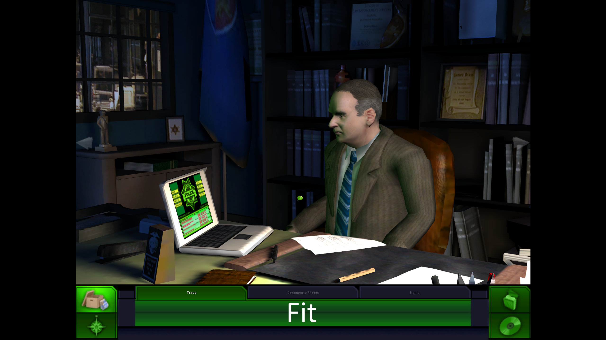
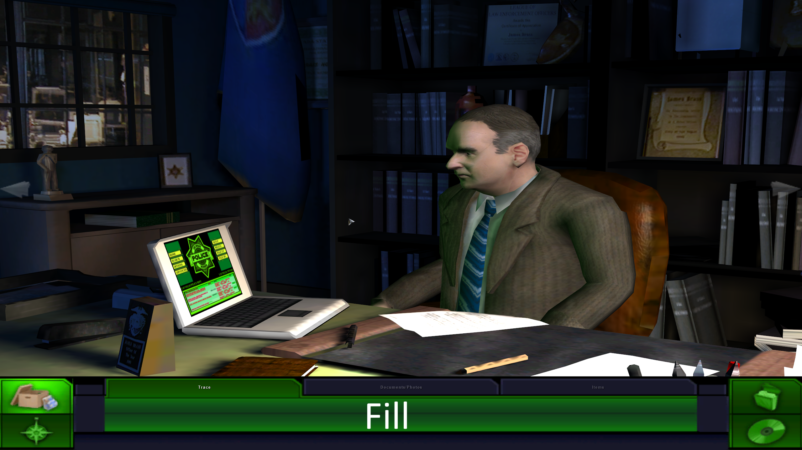

# CSI: 3 Dimensions of Murder — AiO Fix

**Made by Tiger Fury**

Standalone launchers for CSI: 3 Dimensions of Murder, with Original, Fit and Fill display modes.

## Downloads

Get the ZIP for your preferred mode from [Releases](https://github.com/Tiger-Fury/CSI-3-Dimensions-of-Murder-AiO-Fix/releases/latest).

| Mode | Presentation |
| --- | --- |
| Original | Keeps the original game presentation using the working no-CD launcher. |
| Fit | Scales to the primary desktop while preserving a centred 4:3 picture, with black borders. |
| Fill | Stretches the complete 4:3 camera view across the primary desktop, retaining the top and bottom of the picture. |

## Screenshots

### Fit

### Fill

## Features

- Standalone no-CD launchers using the installed game engine and game data.
- Fit and Fill render internally at the enlarged game-window dimensions, improving the clarity of 3D scenes compared with enlarging an 800×600 frame.
- Fit has a dedicated black background window.
- Fill preserves the complete camera view and adjusts both pixel-based picking paths to match the stretched picture.
- Display changes apply in memory for that launcher session. Original game files remain untouched.
- All three launchers can coexist in the same installation.

Higher internal rendering resolution does not replace textures, artwork or videos with higher-resolution assets. This is a native Telltale-engine fix, separate from the Director-based fixes for earlier CSI games.

## Installation

1. Close the game and extract the chosen ZIP.
2. Copy its EXE into the game installation folder, beside **CSI3.exe**, **t3.mll** and the original game data.
3. Start the added EXE directly. Update your shortcut to point to it if desired.

Keep CSI3.exe, t3.mll and the other installed game files. No DLL replacement, dgVoodoo installation or external scaler is required. A complete installed copy of the game is required; these downloads do not include the game or its engine.

## Saves

The launchers do not relocate or migrate saves. Saving and loading without administrator rights were confirmed working by the tester. No save-migration tool is required.

## Testing and compatibility

Original, Fit and Fill were reported working during Windows 11 gameplay testing. Fit's borders, Fill's complete picture and final Fill mouse alignment were confirmed. Higher-resolution rendering and saving/loading without administrator rights were also reported working. Windows 10 has not been independently tested.

The isolated startup/window tests used mocked APIs and a synthetic engine buffer, including desktop sizes from 800×600 to 3840×2160. Final Fill picking checks covered both pixel-ray callbacks at six horizontal positions across seven desktop sizes. These checks supplement user gameplay testing; they are not gameplay benchmarks or a guarantee for every GPU, resolution or game edition.

The inspected t3.mll SHA-256 is `26e61a520afe71506fc549f4d0b58321708dfe8fd279a197232230eeac2e261a`. Fit and Fill validate the engine instructions they adjust and show an error if those sites do not match. Other engine revisions are untested.

## Removal

Delete the added launcher EXEs and use the original launch method. No installed engine or game-data files need restoring. The original disc requirement may apply to the original launcher.

## Source and building

This repository contains the complete source for these generated launchers, not the original game's source code. The builders emit small native x86 PE executables directly using Python's standard library; Python is needed only to rebuild, not to play.

Run `python build.py` with Python 3. Outputs appear in `dist/Original`, `dist/Fit` and `dist/Fill`. The builder verifies that the resulting EXEs exactly match the release hashes in `build-manifest.json`. It does not run the game. The display builders retain the separate tested implementations for reproducibility.

MIT applies to the original launcher-builder code and documentation. No rights to the original game or third-party components are granted. This is an unofficial community fix and is not affiliated with Ubisoft or Telltale Games.
